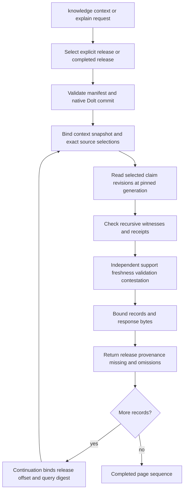
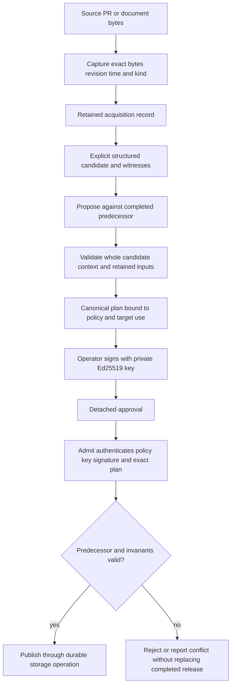
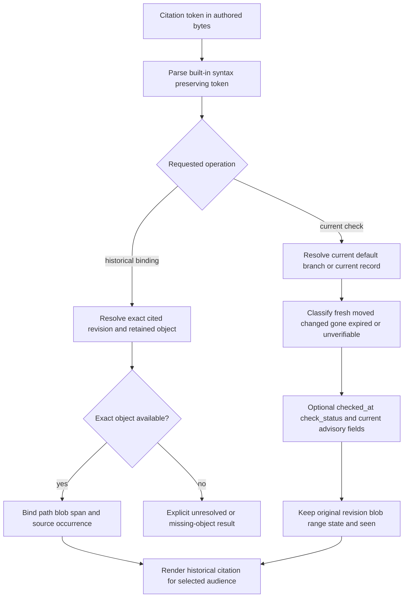
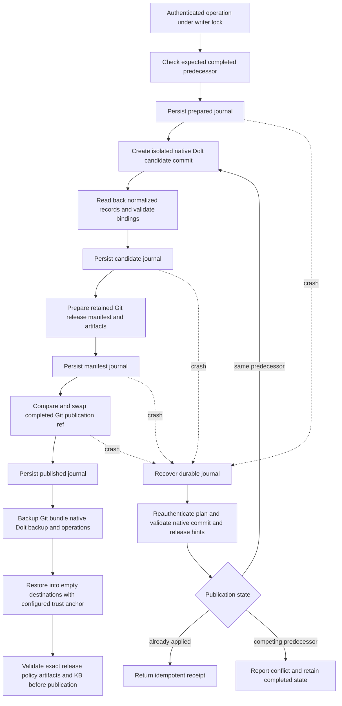

# Operational flows

These diagrams describe current code paths, not gate results or future APIs.
[Workflows](workflows.md) supplies commands; [calculus](calculus.md) defines the
semantic boundary. Authored navigation/graph projection and admitted structured
knowledge are distinct stores and APIs.

## Retrieval

Owner: `services/knowledge.py::context`/`explain`. Limits are 1–100 records,
default 20, and 64 KiB. `complete`, `omitted`, `missing`, `scope_omitted`,
`selection_omitted`, `not_selected`, and `evidence_omitted` describe different
losses. A complete record page does not imply unbounded domain coverage. Detailed
evidence may be removed to fit the ceiling, setting `complete=false`; a single
unrepresentable claim/query fails explicitly. `explain` is the same bounded
retrieval for one exact claim, not a hidden unlimited authority oracle.

Graph navigation instead uses `graph/query_session.py` and
`adapters/dolt/read_session.py`: a session retains its pinned completed graph
generation until explicit refresh. SQL reachability does not establish semantic
support. Qualification pointers: `tests/test_knowledge.py`,
`tests/test_graph_query_session.py`, `tests/test_dolt_read_session.py`.

## Admission

Owner: `services/knowledge.py`, `services/knowledge_models.py`,
`semantics/workflow.py`, `semantics/wellformed.py`. Private signing is CLI-only,
not an engine protocol method. Acquisition success, candidate readiness,
authenticated admission and assessed usability are deliberately different.
Replacing this with “PR merged therefore claim true” or automatic prose approval
would cross the trust boundary. Qualification pointers:
`tests/test_knowledge.py` and `tests/test_knowledge_boundaries.py`.

## Citation

Owners: `citations/syntax.py`, `citations/scan.py`,
`citations/classification.py`, `citations/rendering.py`,
`adapters/git/citations.py`, `graph/extract.py`. Code tokens bind `rev`, `path`,
`blob`, `L`, and normalized `span`; exact object lookup never substitutes HEAD or
worktree bytes. Graph edges preserve occurrence identity (source path/line and
ordinal), so repeated citations do not collapse into one binding. A symbolic or
ambiguous legacy reference is not silently promoted to an exact revision.
Scan parsing is per token: a duplicate-field or unterminated
token is retained as a located `unverifiable`/`malformed` entry with its file
and line rather than aborting the scan for its neighbors. Walks never follow
links: Markdown-suffixed or explicitly selected links are refused, and any
other link is skipped unread.

`checked_at`, `check_status`, `current_rev`, `current_L`, and `current_state` are
advisory fields. In particular, `current_L` belongs to `current_rev`, not to the
historical `rev`. A fresh current check is not a renewed observation and does not
refresh original `seen`. Refreshing retained evidence requires a new capture and,
where applicable, new approval. Redaction controls rendered audience output,
not the truth of the citation. Qualification pointers:
`tests/test_citation_sources.py`, `tests/test_citation_scan.py`,
`tests/test_graph_extract.py`, `tests/test_citation_redaction.py`.

## Storage publication and recovery

The recovery arrow denotes resuming the first unfinished phase; an already
validated candidate or manifest is reused, not blindly recreated. Journal hints
are untrusted until compared with the signed operation. Native Dolt tables own
structured knowledge; Git owns authored assets, retained release manifests and
artifacts. There is no whole-KB JSON blob pretending to be relational storage,
no two independent authoritative writers, and no cross-store transaction claim:
the completed publication ref is the reader-visible boundary.

The authored graph projection has its own candidate-directory/active-pointer
journal in `graph/operations.py`; it remains rebuildable from pinned authored
inputs. This is not the authenticated knowledge release ref. Do not replace one
store's recovery procedure with the other's. Native implementation owners are
`adapters/dolt/knowledge.py`, `adapters/dolt/native.py`,
`adapters/git/knowledge.py` and `services/knowledge.py`.

`graph/inputs.py` fingerprints the complete installed `kctx` Python package,
actual loaded-module locations, direct runtime dependency versions, schema,
semantic version, repository identity and effective normalization settings.
Unloaded modules are hashed without executing them. The earlier hand-maintained
module shortlist missed the JSON storage decoder: changing its installed bytes
left the generation identity unchanged. Package-wide fingerprints fix that
omission and automatically include newly added modules. This deliberately accepts
some unnecessary invalidation after unrelated package changes rather than falsely
calling a generation current after a material dependency changes.

Qualification pointers: `tests/test_storage_publication.py`,
`tests/test_graph_recovery.py`, `tests/test_graph_identity.py`, and
`tests/test_qualification_protocol.py`. Local native recovery/transport evidence
and enterprise endpoint qualification are separate scopes; consult
[gates](gates.md) for actual execution evidence.
