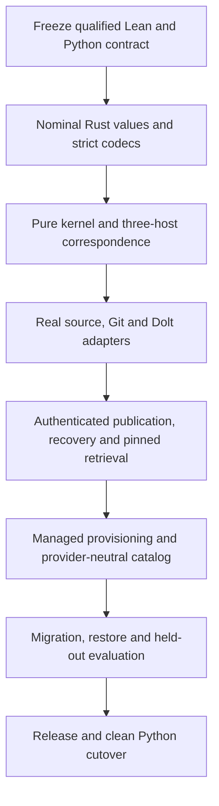

# Rust host design

Design position for the distributable product; the Rust implementation and native
first-run provisioning are not yet shipped. The typed Python host remains the
implementation under qualification. See [catalog design](catalog-design.md) for
provider-neutral extensibility and [calculus revision](calculus-revision.md) for
the semantic contract that every host must satisfy.

## Decision

A native Rust application with a pure, typed semantic kernel; Git for authored
assets and release manifests; Dolt for versioned structured knowledge and SQL
projections. One user-facing application manages the engine and persistence.
Do not embed vendor names or Dolt operations into the calculus. Do not compile
Lean into the runtime or imply that a Rust translation inherits proof status.

The Rust decision functions implement the same versioned semantics as Lean and
Python. The reference suite gains a Rust column; all actual hosts must agree on
reviewed, generated, stateful and mutation cases. Lean remains development/CI
infrastructure, absent from the runtime artifact.

## Why Rust

Rust provides nominal newtypes, exhaustive enums, ownership, immutable views and
explicit error/result contracts suitable for a portable native application. It
also fits the existing gripsack/strop project conventions. This is a host and
operational implementation choice, not a reason to change the knowledge language.

Python remains until the Rust host passes the applicable behavior, persistence,
compatibility and conformance gates. Profiling determines which adapters deserve
replacement; language choice alone is not a latency or correctness result.

## Boundaries

| Crate responsibility | Contract |
| --- | --- |
| Semantic kernel | Pure finite witnesses, assessment, reuse, workflows and conditional operations; no IO/clock/database/client SDKs |
| Wire and codecs | Versioned envelopes, nominal decoding, retained citation grammar, lossless authored documents |
| Catalog | Pinned kind/provider/schema identities and validated extension payloads; no dynamic inference rules |
| Store | Native snapshot selection, expected predecessor, authenticated publication, journal/recovery and retention |
| Git/source adapters | Exact authored/source identity, retained bytes, worktree capture and provider acquisition |
| Dolt adapter | Normalized records and pinned SQL; cannot authorize a claim or operation by itself |
| CLI/agent protocol | Stable structured commands, bounded results, context/receipt identities and explicit omissions |
| Provisioning | Pinned engine installation, private local lifecycle, migrations, backup and diagnostics |

Use a narrow storage interface that captures actual guarantees, not a generic
repository framework. Do not silently replace Dolt with SQLite when unavailable:
versioned history/publication semantics are part of the adapter contract.

## Dolt integration and native distribution

The semantic kernel does not require Dolt. Dolt is retained as the initial backend
because versioned SQL/history/snapshots avoid recreating those mechanisms inside
kctx. A query-only disposable index could use SQLite, but the admitted structured
store is more than a graph cache; any replacement requires measured operational
benefit and full requalification.

Dolt's documented in-process embedding route is a Go `database/sql` driver. A Rust
embedding would introduce a Go runtime/FFI lifecycle and build boundary we would
own. Prefer a managed local `dolt sql-server` and a supported MySQL client rather
than that integration. Batch or long-lived sessions avoid a separate native
process startup for every SQL query; qualify concurrency, commit pinning and
resource use on the chosen client/protocol.

- Ship a statically linked Rust application on supported Linux targets; use
  normal platform-native packaging on macOS rather than calling it a musl target.
- Provision a checksum/signature-verified pinned Dolt executable as an immutable
  companion tool version. Never let ambient PATH choose an incompatible engine.
- Provide an offline bundle containing both executables for restricted networks.
  A self-extracting single download is possible but still contains two runtime
  components; it is not library embedding.
- Bind managed services to private local sockets or authenticated loopback;
  never inherit Dolt's unauthenticated public-server defaults accidentally.
- Manage startup, readiness, cancellation, clean shutdown and crashed-process
  recovery. An upgrade changes tool generation, not database contents by fiat.
- Docker Compose remains the reproducible development/qualification path, not a
  requirement to operate the eventual native Rust product.

## Opinionated workspace ownership

The user initializes or opens a KB and operates knowledge verbs. Kctx owns the
internal schemas, engine version, DB location, candidate directories, locks,
release pointers and recovery protocol. Agents do not administer SQL tables or
edit internal publication pointers.

Git contains editable documents, catalog/policy artifacts, workspace identity,
and immutable release manifests. Live `.dolt` directories are not committed as
ordinary files on the authored branch. Native mutable state and immutable tool
installations remain separate, with disposable caches separate from both.

Default local state is derived from logical KB identity plus local instance
identity so distinct checkouts cannot overwrite one another. Advanced users may
relocate managed state through the single `config.toml`; default provisioning
should not require choosing ports or directory internals. Preserve readable
ordinary Markdown, while providing conventions for managed inventory/proposals/
retained sources rather than imposing a proprietary document filesystem.

A hosted Git repository can transport both authored history and native Dolt data
through different refs. Dolt's Git-backed remote normally uses `refs/dolt/data`;
release manifests pin the native Dolt commit independently of that transport ref.
`kctx sync`/restore coordinate both components and retained evidence. A normal
Git clone alone is not advertised as a complete knowledge restore.

The current Python host has explicit managed-store configuration; the automatic
native provisioning above is a product design, not an implemented command.

## Qualification and rejected shortcuts

Keep exact source/evidence identities; model truth is not manufactured by a SQL
join, a successful fetch, a catalog schema or a session summary. Unknown or
incomplete retrieval remains visible. Kernel proofs and adapter refinement are
separate evidence; a clean axiom audit does not prove a theorem says enough.

Rejected: vendor enums in the kernel, optional silent backend substitution,
embedding Go into Rust merely to claim one binary, committing a live DB tree to
Git, treating an ordinary clone as a complete restore, and adopting a backend
on preference without the fixed correctness/cost evaluation.

## Execution handover

This is a port of a qualified semantic and operational contract, not an
opportunity to simplify away difficult cases. Complete the current Python/Lean
qualification first and freeze its source, wire, fixtures and reports. An
unresolved baseline defect is not a Rust compatibility requirement: fix it in
the semantic authority and both hosts, then update the reviewed expectations.

### Fixed decisions

1. The calculus is provider- and storage-neutral. No Humio/Grafana/GitHub/Dolt
   types or SDKs in the kernel; no database IO, wall clock, randomness or implicit
   current HEAD.
2. Nominal identities are not interchangeable strings. Entity identity, record
   revision, source revision, Git release, native Dolt commit, content digest,
   policy revision and operation identity remain distinct types.
3. Git authored bytes, native structured snapshots and retained captures have
   explicit ownership. A projection or exported context never writes canonical
   facts back without a proposed and authorized operation.
4. The product manages Dolt as a pinned companion. Do not introduce Go/Rust FFI,
   silent backend fallback, or dependency on a separately administered server
   merely to start the application.
5. One `config.toml` controls deployment. Catalogs, policies and release manifests
   are versioned domain artifacts, not additional configuration-precedence layers.
6. Database internals are automatic; trust is not. Users/operators still control
   authority, external credentials, sharing and retention. Initializing a store
   must not silently authorize every agent to admit arbitrary knowledge.
7. The public agent contract is machine-readable, versioned and bounded. Missing
   evidence, partial acquisition, contradiction, omitted context and stale
   receipts remain explicit outcomes.
8. One application owns citations, knowledge workflows and the agent protocol.
   `kctx cite` is a command family, not a separate executable or external script.
   CLI and stdio adapters call the same typed services; neither shells out to
   the other or reconstructs a dynamic argument namespace.

### Phases and dependencies

**Phase 0 — baseline.** Inventory actual commands and formats, freeze the
theorem/operator/fixture registry, retain the original audit counterexamples as
corrected regression cases, and record every supported filesystem/platform.
Do not derive requirements from old test names alone.

**Phase 1 — values and codecs.** Implement the smallest useful kernel/wire crates
first. Use exhaustive tagged unions and validated private constructors. Decode
untrusted bytes directly into validated values; do not first collapse duplicate
keys through a generic JSON map. Preserve canonical operation serialization,
unknown-version refusal and the reference language's resource bounds. Prefer
borrowed views and explicit ownership to avoid needless clones; optimize only
without changing semantic identity or diagnostics.

**Phase 2 — semantics.** Translate the checked functions, not an approximation
of their names. Cover recursive witness checking, positive/negative/both support,
inventory certificates, source selections, material footprints, validation,
authored workflows, admission, replay and retained selection. The Rust reference
runner implements every supported operation; no Python subprocess fallback.

**Phase 3 — adapters and orchestration.** Implement exact Git/capture access,
native Dolt snapshots and SQL sessions, signature verification, expected-base
publication and durable recovery. Use existing qualified protocols rather than
inventing a generic storage framework. Pin a complete generation once per
request, including pagination. Preserve historical versus current-corrected
query modes and do not renew originating evidence times.

**Phase 4 — product experience.** Implement initialization/opening, managed
companion installation, private local service lifecycle, diagnostics, offline
bundles and default workspace storage. Add the catalog contract from
`catalog-design.md`; port legacy provider spellings through explicit profiles.
The agent discovers capabilities and works with typed knowledge verbs, not
raw SQL, engine ports or hidden directories.

**Phase 5 — qualify and cut over.** Exercise migration on representative copies,
native transport/restore, interrupted upgrades, mixed-host interoperability and
the frozen held-out evaluation. Retire Python only after the Rust implementation
passes the same applicable gates. Historical reader versions may be retained as
explicit isolated artifacts; obsolete runtime aliases and fallback paths are
not the cutover design.

## Rust acceptance gates

These gates supplement, not replace, G00–G18 and Q01–Q76/D01–D72 in the
[consolidated handover](handover.md). A kernel-only pass does not qualify the
host. Every row requires commands and receipts from the actual Rust artifact.

| Gate | Required observable evidence | Blocks |
| --- | --- | --- |
| R00 Baseline freeze | Source/wire/semantic versions, representative fixtures, authoritative fields, current gate reports, original counterexamples and explicit intended behavior changes recorded | Starting a port from guessed or knowingly unsound behavior |
| R01 Reproducible artifact | Pinned Rust toolchain and `Cargo.lock`; clean Compose build; supported-target binaries identified by checksum; no host compiler or hidden tool downloads during required offline checks | Distribution claims |
| R02 Nominal values and codecs | Compile-fail wrong-ID/ref/digest tests; malformed/unknown/duplicate/version refusal; canonical round trips; immutable retained inputs; explicit wire-depth/size boundary fixtures | Routing production through unvalidated values |
| R03 Kernel correspondence | Lean/Python/Rust agree on complete responses for every reviewed, generated and stateful case; unsupported/skipped operations fail; all selected semantic mutants are killed | Any Rust semantic assurance claim |
| R04 Real source and citation adapters | Exact original revision/span/bytes survive rename, refresh and correction; live advisory is separate; partial/denied/timeout/missing history remain distinct; source movement and complete declared worktree identity exercised | Replacing acquisition/resolution |
| R05 Authenticated operations | Exact complete candidate/policy/context/source selection signed and checked; self-issued approval and changed material inputs rejected; all new claims authorized; independent actor fields and bound gates; same-input replay and conflicting replay distinguished | Admitted writes |
| R06 Publication and concurrency | Real separate processes interrupted at every durable boundary; one winner per predecessor; last completed generation readable; retry/recovery reuse exact operation; unknown dirty work preserved | Multi-agent authoritative use |
| R07 Dolt/query refinement | Native commits, normalized typed rows, exact binding parity, extraction provenance, pinned multi-table reads/continuation, bounded work and explicit completeness; no WORKING or latest fallback | Reliable relationship or knowledge retrieval |
| R08 Provisioning and lifecycle | Fresh install/start/query/stop with no manually installed Dolt; verified pinned companion; private endpoint; repeated/interrupted install; occupied socket/port, missing permission, crash, offline bundle and rollback exercised; tool rollback never rewinds data | Zero-configuration product claim |
| R09 Catalog and domain neutrality | At least two distinct domains/providers; namespaced kinds and schema versions; rename-stable IDs; unknown extension refusal; catalog changes cannot inject inference or authority; legacy profiles replay faithfully | General-purpose engine claim |
| R10 Migration, retention and restore | Dry-run classifications account for every legacy input; exact bytes/IDs/citations preserved; unresolved records quarantined; repeat idempotent; clean independent restore and authorized rollback/rollforward preserve intervening audit/corrections | Rewriting or retiring existing stores |
| R11 Cost and agent usefulness | Frozen held-out protocol; same selected inputs/meaning; actual model/harness/prompt/tool metadata; correctness and cold/warm latency, memory, IO, subprocess, context/token measures; no post-hoc threshold weakening | Performance or adoption claims |
| R12 Release/cutover | Real installed CLI/agent flows, no Lean/Python/formal artifacts required at runtime; operator guide and recovery drill; applicable earlier gates pass; coherent pushed source and linked reports; old runtime/shims removed | Replacing Python for users |
| R13 Human and machine presentation | Real TTY/pipe captures for help, results, errors, warnings and verbose logs; stream-local color/NO_COLOR; literal untrusted data; stable structured diagnostics; uncontaminated JSON/JSONL; citation operations through the same installed CLI and engine protocol | Shipping the operator or agent interface |

### Required negative cases

The Rust suite must include, not merely mention:

- An OK capture that attests nothing about an unrelated false atom.
- A derived conclusion with an unsupported premise; a mismatching conclusion
  scope; false completeness without an inventory certificate/member witnesses.
- Contradictory evidence without erasure or explosion; a policy change with the
  same friendly policy ID that invalidates the old signed input.
- A newly discovered member; a changed dependency; a retained older capture
  falsely offered as the currently selected source.
- A forged approval, changed signed candidate, unauthorized extra item, malformed
  retained-selection ID and reuse of an immutable snapshot ID for different data.
- Invalid/duplicate modern gates, wrong definition/proposal/target/environment/
  scope/checker/time, and landed refs that resolve to a tree/blob rather than the
  required commit or to unavailable historical bytes.
- A crash after durable candidate creation but before acknowledgement; concurrent
  publishers; an older pinned reader while a new generation is activated.
- Equal graph row counts with swapped destinations/revisions, parser/schema
  change under unchanged authored SHA, and malformed/escaped JSON citations.
- Untrusted retrieved instructions, secret-like error data, ambiguous aliases,
  unsafe paths, unexpected schema versions and resource-limit exhaustion.

### Verification entry points to implement

These are future Rust workflow requirements, not commands already present in
this repository:

1. A Compose quality job runs locked formatting/lint/type/build/unit/property
   checks and the real Rust CLI smoke.
2. The shared conformance orchestrator launches three real hosts and verifies
   response cardinality, IDs, schemas, semantic versions, golden expectations
   and mutation outcomes. Missing a host is a failing gate.
3. The storage/remote qualification harness accepts the Rust executable and
   exercises the same scenarios with native Git/Dolt and process interruption.
4. An isolated runtime image/archive contains no Python, Lean, Lake, Elan or
   formal source, and runs initialization, capture, proposal, signed admission,
   context/explain, citation, recovery and restore through installed entry points.
5. The frozen evaluation protocol runs matched Python/Rust and storage-backend
   trials. A Rust rewrite does not exempt engine startup, maintenance or recovery
   cost from measurement.

Use platform-specific builds and tests rather than assuming a Linux musl artifact
qualifies macOS or another filesystem. Record native engine version and actual
driver/protocol configuration, not just the Rust package version.

## Required handover and release artifacts

Each gate receipt records implementation revision plus source digest, exact
binary and toolchain identities, fixture/corpus/protocol hashes, command, platform,
passed/failed/skipped counts, raw failures, and the scope actually exercised.
Secret material never enters reports. Byte/character proxies are labelled as
proxies rather than presented as measured model-token usage.

The Rust delivery includes:

- Kernel/operator/codec correspondence and theorem-assumption maps.
- Versioned schemas, catalog defaults and legacy migration profiles.
- Reproducible build, runtime and companion-install manifests.
- CLI/API compatibility results and actual source/admission/retrieval examples.
- Real publication/crash/concurrency/restore qualification receipts.
- Exact migration/rollback steps and retained restore points.
- Predeclared cost/agent-evaluation protocol and matched results.
- Operator guidance for initialization, trust bootstrap, credentials, managed
  state locations, upgrade, recovery, backup and diagnostics.
- A per-capability cutover decision. Unverified enterprise policy assumptions
  are not inferred from local Git transport; environment-specific deployment
  testing remains with the operator/work agent as requested.

## Human presentation and machine protocol

Follow Gripsack's separation of diagnostic data, terminal rendering and structured
tracing. Inspected implementation references are
`gripsack-ir/src/diagnostic.rs`, `gripsack/src/render.rs`,
`gripsack-process/src/terminal.rs`, and `gripsack-trace/src/lib.rs` in its crate
workspace. Reuse the house conventions, not a dependency on those private modules.
The current Python implementation uses native Click groups, Rich presentation and
structlog JSONL; the Rust host should use its existing native CLI/tracing stack,
not embed Python for formatting.

### Presentation contract

- A diagnostic is data: versioned code, severity, redacted message, labels with
  source location/notes, optional actionable help, and correlation identity when
  available. Ordinary missing evidence is not an internal-error traceback.
  Codes carry meaning; consumers never parse English text or ANSI sequences.
- Help uses native nested command grammar and consistent headings/options.
  Results use compact tables for comparable records and clearly labelled nested
  details. Partial, stale, unknown and contradictory are visible states, not green
  success labels. Warnings remain visible without replacing successful results.
- Determine color separately for stdout and stderr. Automatic mode requires a
  terminal and honors `NO_COLOR`/dumb terminals; explicit always/never affects only
  human rendering. Piped data remains plain. Do not force a background or depend
  on a particular terminal theme.
- Untrusted filenames, identifiers, source text and provider errors are literal
  data. Escape terminal controls and bidi-formatting characters; never interpret
  their markup, hyperlinks, cursor controls or log prefixes as renderer instructions.
  Renderer-owned styling must not pass through the untrusted-text escape path.
- Source snippets are optional, bounded and read only through the already
  authorized root/revision boundary. A diagnostic must not open arbitrary
  provider-supplied paths to become prettier. Missing source still produces a
  useful diagnostic.
- Normal results go to stdout, human warnings/errors and requested verbose events
  to stderr. Full operation logs remain redacted structured JSONL. Machine mode
  bypasses human rendering entirely, including parser errors and startup failure.
  Do not hide an operation's non-success exit code behind a decorative footer.

### Unified agent surface

Preserve the current `kctx serve` newline-delimited JSON-RPC 2.0 model or introduce
an explicit negotiated protocol version. Initialization advertises exact method
schemas, supported capabilities and frame bounds. The transport version is not
the calculus semantic version. The application includes citation construction,
checking/rendering, authored navigation, pinned graph queries, and authenticated
knowledge operations. Private-key signing remains an explicit operator operation;
no request-supplied `approved=true` substitutes for signature verification.

A graph read session pins its data/metadata generation. Publication does not
silently move that session; explicit refresh opens a valid replacement before
releasing the old reader. Knowledge continuations bind selected release and query
identity. Responses retain operation exit state, generation and completeness.
Notifications, unsupported batches, malformed frames, oversized requests, EOF
and cancellation have specified behavior. An uncertain consequential write must
not be reported as a known rejection or automatically retried.

### Required R13 probes

1. Exercise the installed executable in a real pseudo-terminal and through pipes;
   compare each stream's color decision, including `NO_COLOR`, narrow terminals,
   Unicode and explicit color flags.
2. Send literal ANSI/OSC/bidi/markup-looking names and source errors. They remain
   visible escaped text; output cannot clear the screen, create links, overwrite
   prior rows, or manufacture diagnostic prefixes.
3. Parse stdout as JSON on success, malformed CLI input, unknown command, missing
   configuration and an adapter failure. Warnings belong in structured fields and
   never become extra non-JSON stdout. Verify exit statuses independently.
4. Run citation and knowledge calls in one stdio process. Reject bad versions,
   duplicate keys, wrong scalar types and oversized frames; then accept a valid
   next frame. Verify no help, logs, progress animation or ANSI enters the protocol.
5. Open a pinned graph reader, publish a new generation, query the old reader,
   explicitly refresh and observe the new identity. EOF/shutdown must release its
   native companion and temporary state.

## First actions for the Rust implementer

1. Read this document, `catalog-design.md`, the consolidated handover, the final
   calculus/operator registry and the latest qualification receipts.
2. Verify the frozen Python/Lean baseline yourself through Compose. Resolve any
   mismatch between documentation, schemas and executable behavior before coding.
3. Establish the pinned workspace and implement nominal values plus the reference
   protocol; prove wrong namespaces cannot compile.
4. Port one coherent semantic slice at a time, retaining independent expected
   cases. Keep the three-host matrix green before adding IO.
5. Follow the dependency phases above, commit/push checked checkpoints, and attach
   evidence. Do not call a parser, compiling scaffold or happy-path demo a finished
   engine.

## Sources

- [Dolt's Go embedded driver](https://www.dolthub.com/blog/2026-01-23-golang-sql-drivers/)
  describes the supported in-process Go boundary.
- [Dolt SQL clients](https://www.dolthub.com/docs/sql-reference/supported-clients/clients/)
  documents MySQL compatibility and explicitly lists the Rust `mysql` crate.
- [Dolt Git-backed remotes](https://www.dolthub.com/docs/sql-reference/version-control/remotes/)
  documents native database transport through Git refs and its retention settings.
